# 🛡️ Su Ad Blocker Pro

### Browse Faster. Stay Ad-Free. Protect Your Privacy.

<p align="center">
  <strong>A Lightweight, Privacy-Focused, Multi-Browser Ad Blocking Extension</strong>
</p>

<p align="center">
  
  
  
  
</p>

---

## 📌 Table of Contents

1. [Project Overview](#-1-project-overview)
2. [Project Objectives](#-2-project-objectives)
3. [Features](#-3-features)
4. [Technology Stack](#-4-technology-stack)
5. [System Architecture](#-5-system-architecture)
6. [Software Requirements Specification](#-6-software-requirements-specification-srs)
7. [Project Directory Structure](#-7-project-directory-structure)
8. [Core Module Documentation](#-8-core-module-documentation)
9. [Ad Blocking Workflow](#-9-ad-blocking-workflow)
10. [YouTube Integration](#-10-youtube-integration)
11. [Translation Architecture](#-11-translation-architecture)
12. [PDF Reader Architecture](#-12-pdf-reader-architecture)
13. [Data Storage and Management](#-13-data-storage-and-management)
14. [Browser Compatibility](#-14-browser-compatibility)
15. [Installation and Setup](#-15-installation-and-setup)
16. [Build and Deployment](#-16-build-and-deployment)
17. [Testing Strategy](#-17-testing-strategy)
18. [Debugging Handbook](#-18-debugging-handbook)
19. [Security and Privacy](#-19-security-and-privacy)
20. [Performance Optimization](#-20-performance-optimization)
21. [Known Limitations](#-21-known-limitations)
22. [Development Guidelines](#-22-development-guidelines)
23. [Troubleshooting](#-23-troubleshooting)
24. [Future Development Roadmap](#-24-future-development-roadmap)
25. [Contribution Guidelines](#-25-contribution-guidelines)

---

# 🧩 1. Project Overview

**Su Ad Blocker Pro** is a privacy-focused browser extension designed to improve the browsing experience by blocking unwanted advertisements, reducing tracking activities, and providing additional browsing utilities.

The project is built around the Chromium Manifest V3 extension architecture, with cross-browser support as a core engineering objective.

Unlike traditional browser extensions that depend entirely on external services, Su Ad Blocker Pro prioritizes local processing, browser-native APIs, and user-controlled configurations.

### Core Philosophy

- Fast: Minimize unnecessary network requests and DOM operations.
- Lightweight: Reduce CPU and memory consumption.
- Private: Keep browsing-related information local wherever possible.
- Reliable: Maintain stable functionality across supported browsers.
- Maintainable: Use modular architecture and documented development practices.
- Extensible: Support future improvements without breaking existing features.

### Project Identity

| Property | Description |
|---|---|
| Project Name | Su Ad Blocker Pro |
| Previous Name | Hush |
| Project Type | Browser Extension |
| Architecture | Modular Extension Architecture |
| Manifest | Manifest V3 |
| Primary Target | Chromium-based browsers |
| Secondary Target | Mozilla Firefox |
| Processing Model | Local-first |
| Main Purpose | Advertisement and Tracker Blocking |
| UI Theme | Professional Orange |
| Hosting Requirement | Not required for core functionality |
| Browser Automation | Optional Playwright |

---

# 🎯 2. Project Objectives

The primary objective is to develop a reliable browser extension that provides:

1. Network-level advertisement blocking.
2. Cosmetic advertisement filtering.
3. Third-party tracker protection.
4. YouTube advertisement handling.
5. Browser-level privacy improvements.
6. Custom filtering and allowlisting.
7. Real-time blocking statistics.
8. Integrated PDF reading.
9. Text translation utilities.
10. Cross-browser compatibility.

### Design Principles

| Principle | Engineering Approach |
|---|---|
| Performance | Efficient filtering and minimal DOM processing |
| Privacy | Local storage and minimal external communication |
| Reliability | Error handling and regression testing |
| Modularity | Independent functional modules |
| Compatibility | Browser API abstraction |
| Maintainability | Documentation and structured code |
| Security | Minimum required permissions |

---

# 🚀 3. Features

## 3.1 Advertisement Blocking

- Network request blocking.
- Static filtering rules.
- Dynamic filtering rules.
- Cosmetic filtering.
- Banner advertisement removal.
- Pop-up advertisement protection.
- Third-party advertising request blocking.
- Filter-list management.
- Custom filtering rules.

## 3.2 Tracker Protection

- Third-party tracking protection.
- Tracking-domain filtering.
- Privacy-focused filter lists.
- Reduced unnecessary external requests.

## 3.3 YouTube Integration

- YouTube advertisement detection.
- Skip-button detection and automation.
- Advertisement overlay handling.
- Dynamic DOM monitoring.
- SPA navigation support.
- YouTube selector self-test.
- Search interface protection and stability.

**Important:** YouTube frequently changes its player and advertisement delivery mechanisms. No implementation should promise universal or permanent advertisement removal.

## 3.4 Dashboard and Settings

- Extension status.
- Blocked request statistics.
- Site-specific pause functionality.
- Allowlist management.
- Custom rules.
- Filter-list configuration.
- Settings management.
- About page.

## 3.5 PDF Reader

- Integrated PDF.js reader.
- Local PDF rendering.
- Document navigation.
- Reading interface.

## 3.6 Translation System

- Translation interface.
- Text processing and chunking.
- Translation history.
- Translation service integration.
- Translation model infrastructure where configured.
- Error handling.

## 3.7 Browser Support

- Google Chrome.
- Microsoft Edge.
- Brave.
- Opera.
- Mozilla Firefox.

Actual support depends on browser API compatibility and successful testing.

---

# 🛠️ 4. Technology Stack

The following technologies represent the project's established architecture. Exact package versions and enabled modules must be verified against package.json and the current source code.

| Technology | Purpose |
|---|---|
| JavaScript / TypeScript | Application logic |
| HTML5 | Extension interface |
| CSS3 | UI styling |
| Chrome Extension Manifest V3 | Extension architecture |
| Declarative Net Request API | Network-level blocking |
| Content Scripts | Website interaction |
| MutationObserver | Dynamic DOM monitoring |
| Browser Storage API | Local settings and history |
| Mozilla PDF.js | PDF rendering |
| Transformers.js | Machine-learning translation infrastructure |
| ONNX Runtime Web | Browser-based model execution |
| NLLB Model | Multilingual translation model infrastructure |
| Node.js 22 LTS | Development environment |
| npm | Dependency management |
| Git | Version control |
| Playwright | Optional browser automation |

### Important Technologies

**Manifest V3**

Provides the extension's permission model, background execution architecture, and browser integration.

**Declarative Net Request (DNR)**

Allows the extension to block or modify supported network requests using browser-managed rules.

**Content Scripts**

Interact with website DOM elements, including YouTube's dynamic interface.

**MutationObserver**

Monitors relevant DOM changes. It must be carefully scoped to avoid excessive processing and interference with legitimate website controls.

**PDF.js**

Provides PDF rendering functionality inside the extension.

**Transformers.js and ONNX Runtime Web**

Provide infrastructure for browser-side machine-learning workloads where the corresponding translation implementation is enabled.

---

# 🏗️ 5. System Architecture

## 5.1 High-Level Architecture

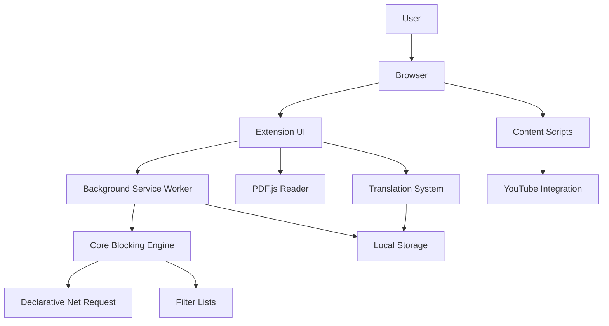

### Architecture Explanation

| Component | Responsibility |
|---|---|
| Extension UI | User interaction |
| Background Service Worker | Background operations |
| Core Blocking Engine | Rule processing |
| DNR | Network request filtering |
| Content Scripts | Website-level interaction |
| YouTube Integration | Video platform-specific behavior |
| Filter Lists | Advertisement and tracker definitions |
| Local Storage | Settings and history |
| PDF.js | PDF rendering |
| Translation System | Translation processing |

## 5.2 Component Communication

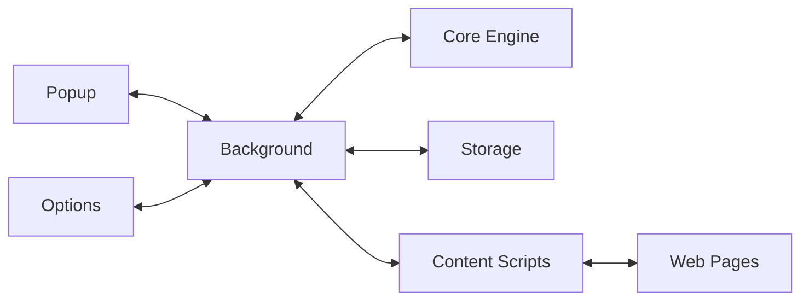

The actual communication mechanisms may include extension messaging, browser APIs, and local storage.

---

# 📋 6. Software Requirements Specification (SRS)

## 6.1 Introduction

### Purpose

This section defines the functional and non-functional requirements of Su Ad Blocker Pro.

### Scope

The system is a browser extension intended to block unwanted advertisements, reduce tracking, and provide supplementary browsing utilities.

## 6.2 Functional Requirements

| ID | Requirement | Priority |
|---|---|---|
| FR-01 | Enable and disable protection | Critical |
| FR-02 | Block supported advertising requests | Critical |
| FR-03 | Apply cosmetic filtering | High |
| FR-04 | Manage filter lists | High |
| FR-05 | Support allowlisted websites | High |
| FR-06 | Support custom filtering rules | High |
| FR-07 | Display actual blocking statistics | High |
| FR-08 | Detect YouTube ad states | High |
| FR-09 | Handle available YouTube skip controls | High |
| FR-10 | Preserve YouTube search functionality | Critical |
| FR-11 | Support YouTube SPA navigation | High |
| FR-12 | Provide integrated PDF reading | Medium |
| FR-13 | Maintain translation history | Medium |
| FR-14 | Persist user settings | High |
| FR-15 | Support Chrome and Firefox builds | Critical |

## 6.3 Non-Functional Requirements

| ID | Requirement | Expected Behavior |
|---|---|---|
| NFR-01 | Performance | Minimal browsing overhead |
| NFR-02 | Reliability | No unintended DOM removal |
| NFR-03 | Security | Minimum necessary permissions |
| NFR-04 | Privacy | Avoid unnecessary data transmission |
| NFR-05 | Compatibility | Browser-specific API handling |
| NFR-06 | Maintainability | Modular code |
| NFR-07 | Scalability | Efficient rule management |
| NFR-08 | Usability | Simple and accessible UI |
| NFR-09 | Stability | No continuous unnecessary polling |
| NFR-10 | Recovery | Graceful handling of errors |

## 6.4 System Constraints

- Manifest V3 restrictions must be respected.
- Remote executable JavaScript must not be downloaded and executed.
- Browser-specific APIs must be handled correctly.
- DNR rules must comply with browser limits.
- YouTube's DOM is dynamic and can change without notice.
- Browser automation may be unavailable in some development environments.
- Some advertisements cannot be reliably removed by DOM manipulation.

## 6.5 Use Case Diagram

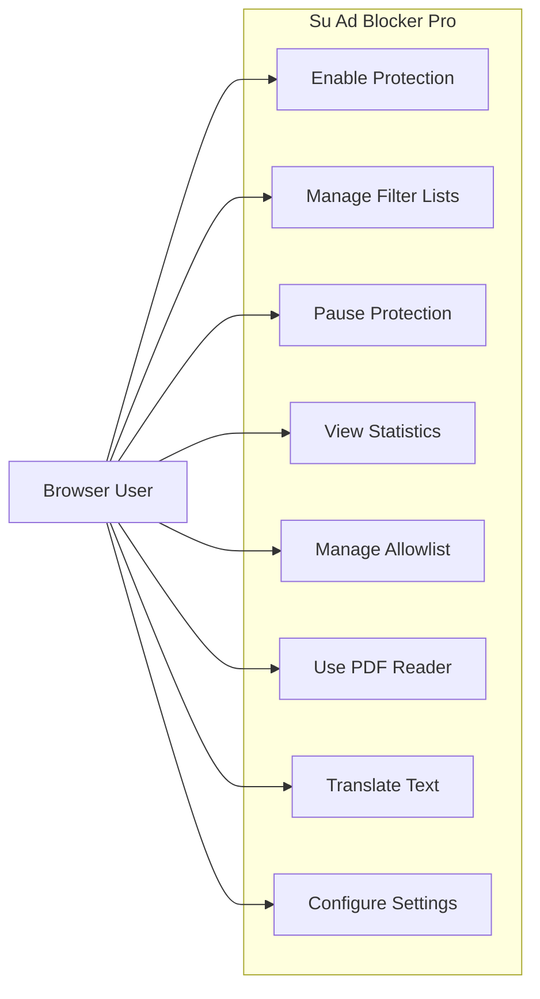

## 6.6 Acceptance Criteria

The project should not be considered complete until:

- Both browser builds are successful.
- Core network filtering is verified.
- Cosmetic filtering is verified.
- Settings persist correctly.
- Allowlist behavior works.
- Statistics reflect actual events.
- YouTube search remains functional.
- YouTube navigation does not break content scripts.
- Existing features pass regression testing.
- No critical security issue remains.

---

# 📂 7. Project Directory Structure

The following is a logical architecture map based on the established project modules. It is not a substitute for the actual repository tree.

```text
su-ad-blocker-pro/
│
├── CLAUDE.md
├── .cursorrules
├── README.md
├── package.json
├── package-lock.json
├── manifest.json
│
├── docs/
│   ├── PRD.md
│   ├── SRS.md
│   ├── ARCHITECTURE.md
│   ├── TECHNICAL_DOCUMENTATION.md
│   ├── DATABASE_SCHEMA.md
│   ├── API_DOCUMENTATION.md
│   ├── TESTING_GUIDE.md
│   ├── DEBUGGING_GUIDE.md
│   ├── SECURITY.md
│   ├── CHANGELOG.md
│   ├── 06_Plan.md
│   └── FINAL_AUDIT_REPORT.md
│
├── core/
│   ├── blocking/
│   ├── filtering/
│   ├── rules/
│   ├── storage/
│   ├── background/
│   └── utilities/
│
├── dashboard/
│   ├── dashboard.html
│   ├── dashboard.css
│   ├── dashboard.js
│   ├── error-guard.js
│   └── pages/
│
├── translator/
│   ├── online-translation-service.js
│   ├── translation-engine.js
│   ├── model-loader.js
│   ├── text-chunker.js
│   ├── lexicon.js
│   ├── transformers.min.js
│   └── pdf-reader/
│       └── reader.html
│
├── content/
│   ├── youtube/
│   ├── cosmetic/
│   └── scripts/
│
├── assets/
│   ├── icons/
│   ├── images/
│   └── fonts/
│
├── tests/
│   ├── unit/
│   ├── integration/
│   └── fixtures/
│
├── scripts/
│   ├── build/
│   └── filters/
│
└── dist/
    ├── chrome/
    └── firefox/
```

**Directory verification requirement:** The development agent must compare this logical structure against the actual repository. Do not create empty folders just to match this diagram. Update the README when modules are moved or renamed.

---

# ⚙️ 8. Core Module Documentation

## 8.1 Background Service Worker

Responsibilities:

- Initialize extension services.
- Coordinate blocking operations.
- Handle extension messages.
- Manage relevant browser events.
- Maintain settings.
- Coordinate rule updates.

Debugging checklist:

- Is the service worker registered?
- Are initialization errors present?
- Are permissions correct?
- Are messages being received?
- Are asynchronous operations handled correctly?

## 8.2 Blocking Engine

Responsibilities:

- Process filtering rules.
- Manage supported DNR rules.
- Handle static and dynamic rule configurations.
- Coordinate filter updates.
- Avoid unnecessary rule recompilation.

Debugging checklist:

- Are rules generated correctly?
- Are duplicate rules removed?
- Are invalid rules rejected?
- Are DNR limits respected?
- Are allowlist exceptions applied?

## 8.3 Content Script System

Responsibilities:

- Interact with website DOM.
- Apply cosmetic filtering.
- Handle supported website-specific behavior.
- Coordinate with the background system.

Debugging checklist:

- Is the content script injected?
- Are selectors valid?
- Are DOM operations safe?
- Are event listeners duplicated?
- Is the observer lifecycle controlled?

## 8.4 Dashboard

Responsibilities:

- Show extension status.
- Display blocking statistics.
- Provide user controls.
- Manage configuration.

Important existing files include:

- dashboard.html
- dashboard.css
- dashboard.js
- error-guard.js

## 8.5 Filter Management

Responsibilities:

- Load supported filter data.
- Parse filter entries.
- Compile supported rules.
- Deduplicate rules.
- Maintain update state.

**Protected component:** The existing Ad Blocker Fetcher must not be modified during unrelated debugging or feature development.

---

# 🔄 9. Ad Blocking Workflow

## 9.1 Network Blocking Sequence

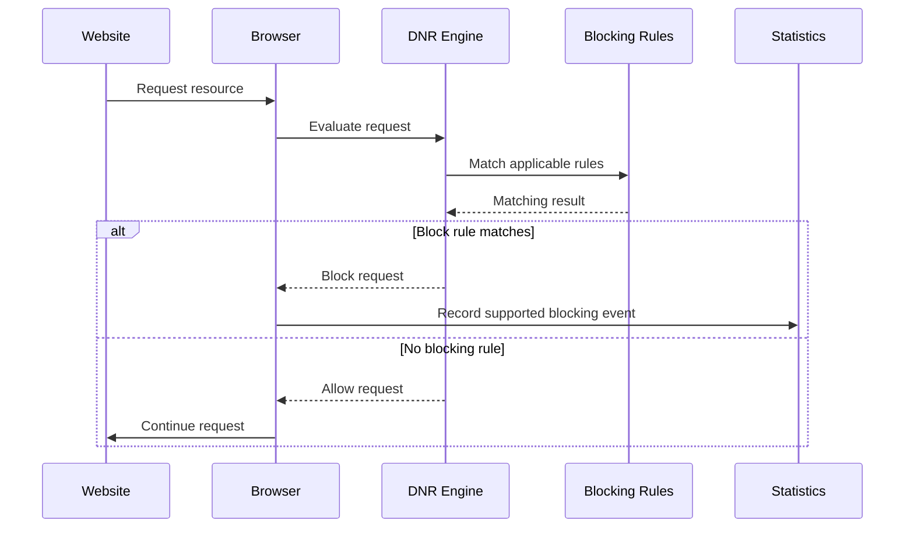

## 9.2 Cosmetic Filtering

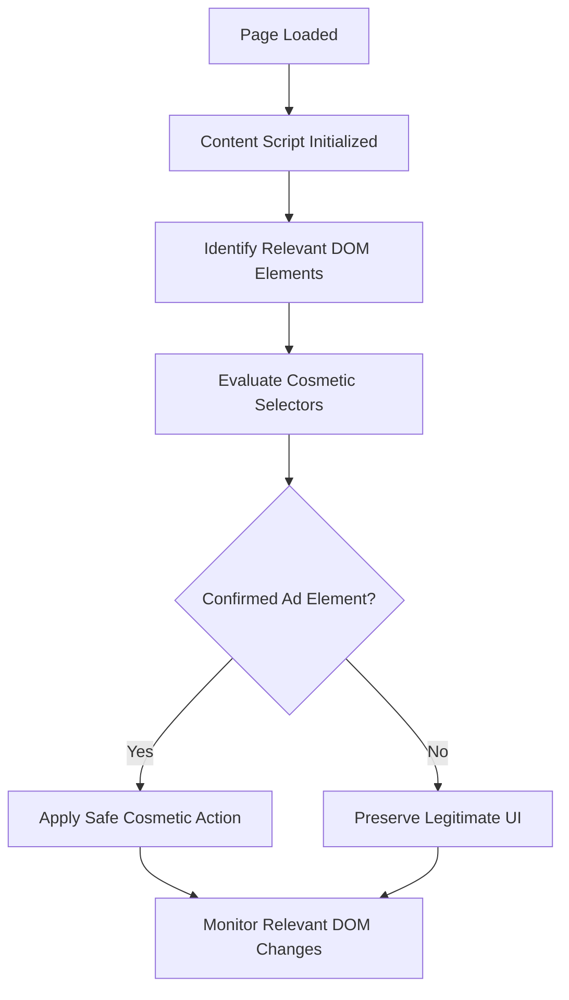

Cosmetic filtering must never remove essential interactive website components.

---

# ▶️ 10. YouTube Integration

YouTube requires special handling because it uses a dynamic Single Page Application architecture.

## 10.1 Main Responsibilities

- Advertisement state detection.
- Skip control detection.
- Advertisement overlay handling.
- Dynamic player monitoring.
- SPA navigation handling.
- Search UI protection.
- Selector health checks.

## 10.2 YouTube Architecture

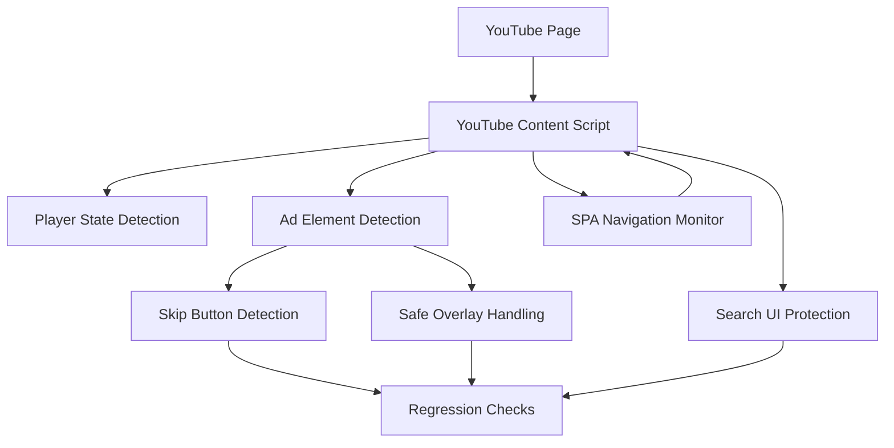

## 10.3 YouTube Search Stability Requirements

The following interface elements must remain functional:

- Search input.
- Search button.
- Search form.
- Search suggestions.
- Keyboard navigation.
- Search focus behavior.

### Critical debugging targets

```text
MutationObserver
CSS injection
Cosmetic selectors
DOM removal functions
Mouse event listeners
Focus and blur handlers
YouTube SPA navigation
Search suggestion lifecycle
```

### Regression Test

| Test | Expected Result |
|---|---|
| Mouse hover | Search stays visible |
| Click input | Focus works |
| Type text | Text appears normally |
| Backspace | Editing works |
| Enter | Search executes |
| Suggestions | Dropdown remains visible |
| SPA navigation | Search remains functional |

### Important Engineering Rule

YouTube advertisement cleanup must use precise element identification.

Never remove a parent container without confirming that it contains only the intended advertisement component.

---

# 🌐 11. Translation Architecture

The translation subsystem contains text processing and translation service/model infrastructure.

## 11.1 Main Components

| Component | Responsibility |
|---|---|
| Translation Engine | Coordinates translation |
| Online Translation Service | Online translation integration |
| Model Loader | Model initialization where enabled |
| Text Chunker | Splits large text |
| Lexicon | Language-related processing |
| Transformers.js | ML infrastructure |
| ONNX Runtime Web | Browser model execution |
| Translation History | Stores translation records |

## 11.2 Translation Flow

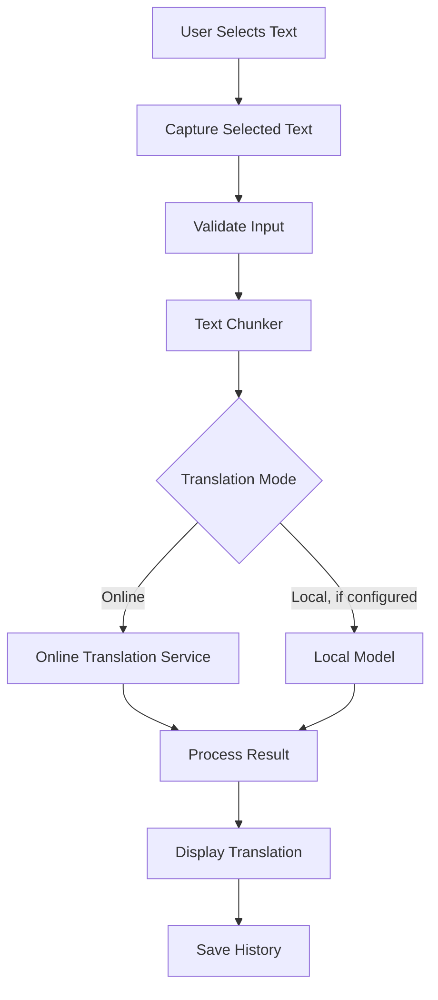

The actual active translation mode must be verified in the current implementation. Model availability and browser memory constraints may affect local inference.

## 11.3 Translation Debugging

Check:

- Selected text capture.
- Empty input handling.
- Chunk boundaries.
- API errors.
- Model loading failures.
- ONNX runtime initialization.
- Bengali Unicode rendering.
- Translation history persistence.

---

# 📄 12. PDF Reader Architecture

The integrated PDF reader uses Mozilla PDF.js.

## 12.1 Workflow

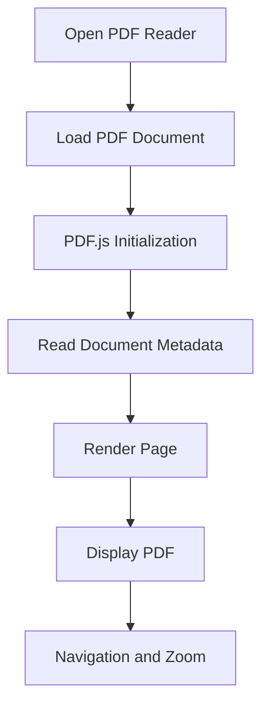

## 12.2 Debugging Checklist

- Verify PDF.js script loading.
- Check worker configuration.
- Check PDF file access.
- Check document loading errors.
- Verify page rendering.
- Verify navigation and zoom.
- Check memory usage for large PDFs.

---

# 💾 13. Data Storage and Management

The extension prioritizes browser-local storage.

Potential storage categories include:

| Data | Storage Responsibility |
|---|---|
| User Settings | Configuration |
| Allowlist | Site exceptions |
| Custom Rules | User-defined filters |
| Translation History | Past translations |
| Blocking Statistics | Usage metrics |
| Filter Metadata | Update information |

### Data Flow

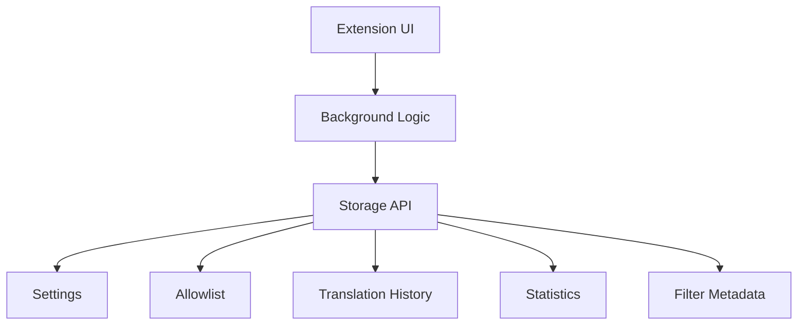

The actual storage keys and schemas must be documented from the source code. Avoid introducing duplicate storage systems.

---

# 🌍 14. Browser Compatibility

| Browser | Target | Verification |
|---|---|---|
| Google Chrome | Primary | Required |
| Microsoft Edge | Chromium-based | Required |
| Brave | Chromium-based | Required |
| Opera | Chromium-based | Required |
| Firefox | Secondary | Required |

### Compatibility Considerations

- Manifest differences.
- Background execution differences.
- Storage APIs.
- Declarative Net Request support.
- Content script injection.
- Browser messaging.
- Extension permissions.

Do not assume that successful Chromium builds guarantee Firefox functionality.

---

# 💻 15. Installation and Setup

## 15.1 Prerequisites

| Software | Recommended |
|---|---|
| Node.js | 22 LTS |
| npm | Version compatible with lockfile |
| Git | Latest stable |
| Google Chrome | Current stable |
| Mozilla Firefox | Current stable |
| Code Editor | VS Code / Antigravity / Cursor |
| Operating System | Windows, Linux, macOS |

## 15.2 Clone the Project

```bash
git clone YOUR_REPOSITORY_URL
cd su-ad-blocker-pro
```

Replace the repository URL with the actual Git repository.

## 15.3 Install Dependencies

```bash
npm ci
```

If installation fails, inspect the error before changing dependency versions.

## 15.4 Inspect Available Scripts

```bash
npm run
```

This is important because the actual package.json is the authoritative source for available commands.

---

# 🔨 16. Build and Deployment

## 16.1 Chrome Build

```bash
npm run build:chrome
```

Expected output directory:

```text
dist/chrome/
```

## 16.2 Firefox Build

```bash
npm run build:firefox
```

Expected output directory:

```text
dist/firefox/
```

## 16.3 Filter Maintenance

If these scripts exist in package.json:

```bash
npm run update-lists
npm run build-rulesets
```

Run them according to the project's filter maintenance workflow.

## 16.4 Load in Chrome

1. Open `chrome://extensions`.
2. Enable Developer mode.
3. Select Load unpacked.
4. Choose `dist/chrome`.
5. Reload the extension after rebuilding.

For Edge:

```text
edge://extensions
```

## 16.5 Load in Firefox

1. Open `about:debugging#/runtime/this-firefox`.
2. Select Load Temporary Add-on.
3. Select `dist/firefox/manifest.json`.

Firefox temporary installations may need to be loaded again after restarting the browser.

---

# 🧪 17. Testing Strategy

Testing must cover unit, integration, build, and real browser behavior.

## 17.1 Testing Pyramid

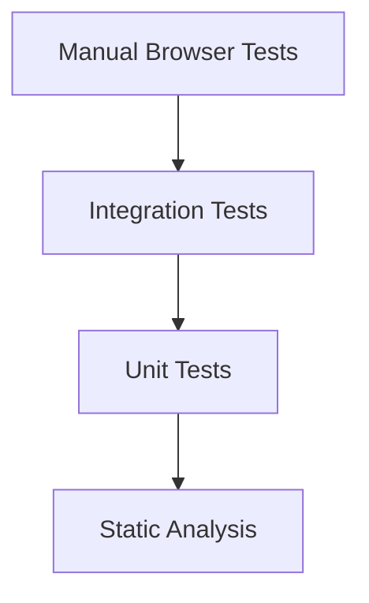

## 17.2 Unit Testing

Test:

- Filter parsing.
- Rule generation.
- Rule validation.
- Allowlist matching.
- Storage utilities.
- Text chunking.
- Translation processing.

## 17.3 Integration Testing

Test:

- Background messaging.
- DNR configuration.
- Content script communication.
- Storage persistence.
- Popup functionality.
- Filter updates.

## 17.4 Browser Testing

Test:

- Real advertisement blocking.
- YouTube player behavior.
- Search functionality.
- SPA navigation.
- Settings persistence.
- Cross-browser compatibility.

## 17.5 Playwright

Playwright is an optional automated browser testing tool.

Install browsers only when the environment supports it:

```bash
npx playwright install chromium firefox
```

If installation is unavailable, continue with other tests.

Do not report automated E2E testing as successful when it has not run.

---

# 🐞 18. Debugging Handbook

This section is especially important for future maintenance.

## 18.1 General Debugging Workflow

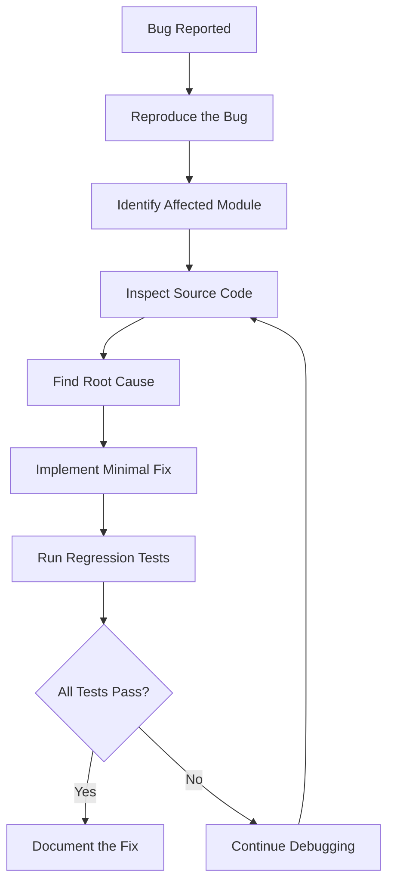

## 18.2 Chrome Debugging

Open:

```text
chrome://extensions
```

Check:

- Extension errors.
- Service worker inspection.
- Permissions.
- Manifest errors.
- Reload behavior.

For content scripts, open the affected website and use Developer Tools.

## 18.3 Firefox Debugging

Open:

```text
about:debugging#/runtime/this-firefox
```

Inspect:

- Extension console.
- Background execution.
- Content script errors.
- API compatibility.

## 18.4 YouTube Debugging

When YouTube functionality breaks, inspect these areas first:

1. Content script injection.
2. Selector definitions.
3. MutationObserver callbacks.
4. DOM cleanup functions.
5. Cosmetic CSS.
6. SPA navigation handlers.
7. Event listener lifecycle.

### Search Bar Disappearing Bug

If the search bar disappears when hovered or focused:

```text
Investigate:
    YouTube content scripts
    Cosmetic filtering
    MutationObserver
    remove() / removeChild()
    CSS injection
    Search input lifecycle
    Parent container removal
    Mouse and focus event listeners
```

Never solve this by disabling all YouTube advertisement protection.

## 18.5 Performance Debugging

Use Chrome DevTools Performance and Memory panels.

Check:

- CPU usage.
- Memory growth.
- Long-running tasks.
- Repeated DOM queries.
- Excessive observer callbacks.
- Duplicate event listeners.
- Unnecessary background operations.

---

# 🔐 19. Security and Privacy

## 19.1 Security Principles

- Request only necessary browser permissions.
- Keep sensitive data local.
- Do not expose private API credentials.
- Validate external filter data.
- Avoid unsafe DOM injection.
- Avoid executing downloaded JavaScript.
- Use safe messaging practices.
- Handle malformed input.
- Avoid unnecessary telemetry.

## 19.2 Manifest V3 Security

Remote executable code must not be downloaded and executed.

Filter-list updates should be treated as data and validated before being compiled into supported browser rules.

## 19.3 Privacy

The extension should not transmit browsing history, selected text, or personal information unnecessarily.

Any external translation service or remote filter source must be documented transparently.

---

# ⚡ 20. Performance Optimization

Performance improvements should focus on measurable bottlenecks.

| Area | Optimization |
|---|---|
| Network Blocking | Browser-native DNR |
| Filter Processing | Deduplication and efficient parsing |
| DOM Processing | Targeted selectors |
| MutationObserver | Scoped observation |
| Background | Minimal unnecessary work |
| Storage | Efficient updates |
| UI | Lightweight rendering |
| Translation | Controlled chunk sizes |
| PDF Reader | Efficient page rendering |

### Performance Rules

1. Avoid continuous full-document scanning.
2. Avoid unnecessary setInterval loops.
3. Do not recreate unchanged filtering rules.
4. Avoid excessive synchronous DOM manipulation.
5. Disconnect observers when no longer required.
6. Avoid duplicate event listeners.
7. Measure before and after optimization.

---

# ⚠️ 21. Known Limitations

The following limitations should be considered during development:

- YouTube can change its advertisement and player implementation.
- Some ads may not be skippable through available browser interfaces.
- Browser-native rule limits vary.
- Firefox and Chromium APIs have differences.
- Large translation models may require substantial memory.
- Some websites may break under aggressive cosmetic filtering.
- Playwright may be unavailable in restricted environments.
- Successful builds do not prove real-world blocking effectiveness.

Document newly discovered limitations in the project's issue tracker or debugging report.

---

# 🗺️ 22. Development Guidelines

## 22.1 Before Modifying Code

1. Read project documentation.
2. Inspect relevant modules.
3. Understand dependencies.
4. Identify existing behavior.
5. Check Git status.
6. Create a debugging plan.

## 22.2 While Modifying Code

- Preserve existing features.
- Make minimal, targeted changes.
- Avoid unnecessary dependencies.
- Avoid unrelated refactoring.
- Add tests where appropriate.
- Update relevant documentation.

## 22.3 After Modifying Code

Run:

```bash
npm run
```

Then execute the applicable checks listed in package.json.

Build:

```bash
npm run build:chrome
npm run build:firefox
```

Review:

```bash
git status
git diff
```

## 22.4 Protected Component: Ad Blocker Fetcher

The existing Ad Blocker Fetcher is a protected component.

Unless explicitly authorized:

- Do not refactor it.
- Do not change its implementation.
- Do not change its configuration.
- Do not replace its fetching mechanism.

For unrelated bug fixes, verify its integrity through Git diff and file hashes.

---

# 🔧 23. Troubleshooting

| Problem | Possible Cause | Investigation |
|---|---|---|
| Extension not loading | Manifest error | Validate manifest |
| Chrome build fails | Dependency or compilation issue | Inspect build output |
| Firefox build fails | Browser-specific incompatibility | Inspect Firefox manifest |
| Ads still visible | Missing or outdated rules | Inspect rule generation |
| YouTube ads not handled | Player DOM changes | Inspect YouTube integration |
| Search bar disappears | DOM/CSS conflict | Inspect observers and cleanup |
| Statistics incorrect | Event accounting issue | Inspect statistics logic |
| Settings not saved | Storage error | Inspect storage operations |
| PDF not loading | PDF.js worker issue | Inspect worker configuration |
| Translation fails | Service/model initialization issue | Inspect translation logs |
| High CPU usage | Excessive DOM monitoring | Profile observers |
| Playwright installation fails | Browser installation environment | Continue with available tests |

### Windows PowerShell Commands

```powershell
node -v
npm -v
git --version
npm run
```

Check the Playwright installation:

```powershell
npx playwright --version
npx playwright install --list
```

These checks are optional if Playwright is not being used.

---

# 🚀 24. Future Development Roadmap

The following roadmap represents proposed improvements, not claims that these features are already complete.

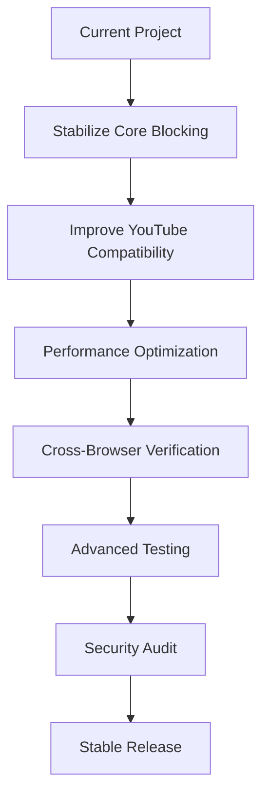

### Priority-Based Roadmap

| Priority | Development Area |
|---|---|
| P0 | Core ad-blocking reliability |
| P0 | YouTube search stability |
| P0 | Preserve existing features |
| P1 | YouTube ad detection improvements |
| P1 | Performance optimization |
| P1 | Cross-browser testing |
| P2 | Advanced diagnostics |
| P2 | Improved statistics |
| P3 | Additional privacy features |

---

# 🤝 25. Contribution Guidelines

Contributors should follow these guidelines:

1. Understand the existing architecture before making changes.
2. Avoid unnecessary refactoring.
3. Preserve backward compatibility.
4. Add tests for bug fixes.
5. Document configuration changes.
6. Verify both Chrome and Firefox builds.
7. Provide reproducible bug reports.
8. Never claim untested functionality is working.

### Bug Report Template

```text
Bug Title:

Browser:
Browser Version:
Extension Version:

Affected Module:

Steps to Reproduce:

Expected Behavior:

Actual Behavior:

Console Errors:

Screenshots / Logs:

Reproduction Frequency:
```

### Feature Request Template

```text
Feature Name:

Problem:

Proposed Solution:

Affected Modules:

Expected Benefits:

Performance Considerations:

Security Considerations:

Testing Requirements:
```

---

# 📜 License and Usage

**Project:** Su Ad Blocker Pro

**Usage:** Personal development project.

Unless a separate license is added by the project owner, do not assume that this repository grants permission for redistribution or commercial use.

Third-party libraries and assets remain subject to their respective licenses.

---

# 👨‍💻 Project Maintainer

**Su Ad Blocker Pro**

*Browse Faster. Stay Ad-Free. Protect Your Privacy.*

Built with a focus on performance, privacy, reliability, and maintainability.

---

<p align="center">
  <strong>SU AD BLOCKER PRO</strong><br/>
  <sub>Fast Browsing. Better Privacy. Smarter Blocking.</sub>
</p>

