# 🎓 UniPortal Monitor
### Cross-Browser University Portal Notification & Monitoring Extension

<p align="center">
  
  
  
  
</p>

<p align="center">
  <b>One Extension. Two University Portals. One Unified Notification System.</b>
</p>

UniPortal Monitor is a cross-browser browser extension designed to monitor the academic portals of **United International University (UIU)**.

It automatically checks the UCAM and ELMS portals for new academic activities, including notices, study materials, assignments, announcements, and other supported updates.

The extension uses the browser's existing authenticated session instead of asking students to provide or store their university passwords.

Its architecture is designed around modular portal adapters, background monitoring, change detection, local storage, and browser-native notifications.

---

# 📑 Table of Contents

1. Project Overview
2. Key Features
3. System Requirements Specification (SRS)
4. System Architecture
5. Application Workflow
6. Technology Stack
7. Project Directory Structure
8. Portal Integration Architecture
9. Data and Storage Architecture
10. Security and Privacy
11. Browser Compatibility
12. Installation and Setup
13. Development Workflow
14. Build and Distribution
15. Testing Strategy
16. Debugging and Troubleshooting
17. Maintenance and Future Improvements
18. Known Limitations
19. Contribution Guidelines
20. License and Disclaimer

---

# 1. Project Overview

## 1.1 Project Information

| Property | Description |
|---|---|
| Project Name | UniPortal Monitor |
| Project Type | Cross-Browser Extension |
| Primary Institution | United International University |
| Primary Portals | UCAM and ELMS |
| Architecture | Modular Adapter-Based Architecture |
| Extension Standard | Manifest V3 |
| Authentication | Existing Browser Session |
| Data Storage | Browser Local Storage |
| Notification | Browser Notifications API |
| Monitoring Interval | 30 Minutes |
| Target Platforms | Chromium Browsers and Firefox |

## 1.2 Problem Statement

Students frequently need to visit multiple university portals to check for newly published academic information.

Manually checking these portals creates several problems:

- Students may miss important announcements.
- New assignments or study materials may go unnoticed.
- Repeatedly checking multiple websites wastes time.
- There is no unified notification mechanism.
- Students may not immediately notice important academic updates.

UniPortal Monitor addresses these problems through automated portal monitoring and centralized notifications.

## 1.3 Project Objectives

- Automatically monitor UCAM and ELMS.
- Detect newly published academic information.
- Notify students when new content is available.
- Support multiple browsers.
- Avoid storing university passwords.
- Provide a simple and professional user interface.
- Maintain a modular architecture for future maintenance.
- Minimize unnecessary requests to university servers.

---

# 2. Key Features

| Feature | Description |
|---|---|
| UCAM Monitoring | Checks supported UCAM academic information |
| ELMS Monitoring | Checks supported ELMS academic information |
| Automatic Checking | Periodic monitoring using browser alarms |
| Change Detection | Compares new data with previously stored snapshots |
| Desktop Notifications | Displays notifications for detected updates |
| Badge Updates | Displays monitoring information on the extension icon |
| Session Authentication | Uses existing browser login sessions |
| Local Storage | Stores monitoring snapshots and settings |
| Custom Notification Sound | Browser-dependent audio notification support |
| Popup Dashboard | Displays monitoring status and recent information |
| Options Page | Provides configuration options |
| Cross-Browser Builds | Generates separate browser distributions |

## 2.1 Monitoring Flow

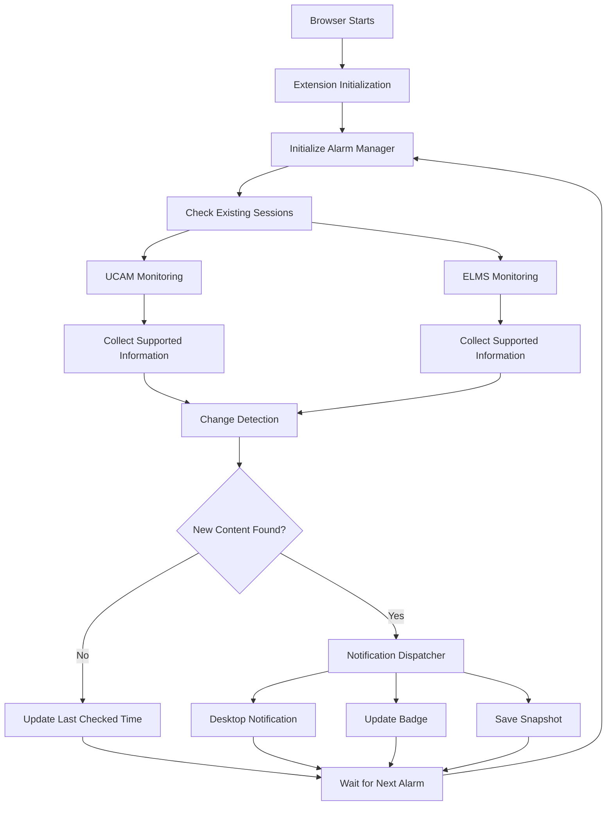

---

# 3. Software Requirements Specification (SRS)

## 3.1 Purpose

This section defines the functional and non-functional requirements of UniPortal Monitor.

It serves as a reference for developers, maintainers, testers, and future contributors.

## 3.2 Scope

The system monitors two university portals:

1. UCAM — University Course and Academic Management Portal.
2. ELMS — Electronic Learning Management System.

The extension operates within the browser and uses authenticated sessions already established by the student.

## 3.3 Functional Requirements

| ID | Requirement | Priority |
|---|---|---|
| FR-01 | The system shall initialize when the browser loads the extension. | High |
| FR-02 | The system shall schedule periodic monitoring. | High |
| FR-03 | The system shall detect the existing UCAM session. | High |
| FR-04 | The system shall detect the existing ELMS session. | High |
| FR-05 | The system shall retrieve supported portal information. | High |
| FR-06 | The system shall parse supported HTML content. | High |
| FR-07 | The system shall compare new data with previous snapshots. | High |
| FR-08 | The system shall detect newly published information. | High |
| FR-09 | The system shall generate desktop notifications. | High |
| FR-10 | The system shall update the extension badge. | Medium |
| FR-11 | The system shall store monitoring snapshots locally. | High |
| FR-12 | The system shall display monitoring status in the popup. | High |
| FR-13 | The system shall support user-configurable settings where implemented. | Medium |
| FR-14 | The system shall support separate browser builds. | High |
| FR-15 | The system shall handle expired or unavailable sessions gracefully. | High |

## 3.4 Non-Functional Requirements

### Performance

- Monitoring should not unnecessarily consume CPU or memory.
- Requests should be made only when required.
- HTML parsing should be efficient.
- The interface should load quickly.

### Security

- University passwords must never be stored.
- Authentication must rely on existing browser sessions.
- Sensitive session information must not appear in logs.
- Requests must be restricted to approved portal origins.
- External analytics or tracking should not be introduced without explicit justification.

### Reliability

- Background monitoring should recover after browser restarts.
- Failed requests should not corrupt previous snapshots.
- Temporary network failures should not permanently stop monitoring.
- Duplicate notifications should be minimized.

### Maintainability

- UCAM and ELMS logic should remain separated.
- Shared functionality should be reusable.
- TypeScript types should be maintained.
- Tests should cover parsing and change detection.
- Portal selectors should be easy to update.

### Compatibility

- Support the intended Chromium browsers.
- Support Firefox through a browser-specific build.
- Avoid unnecessary browser-specific dependencies in shared modules.

## 3.5 Use Case Diagram

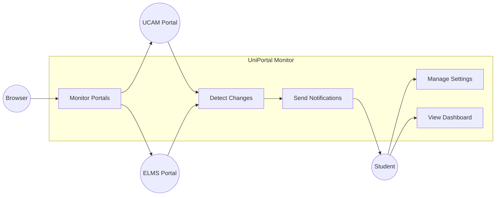

---

# 4. System Architecture

## 4.1 Architectural Pattern

The application follows a modular architecture using separate portal adapters.

Each portal has its own authentication/session handling, data collection, and parsing logic.

Shared components handle scheduling, orchestration, change detection, notifications, and storage.

This separation makes it possible to modify one portal integration without unnecessarily changing the other.

## 4.2 High-Level Architecture

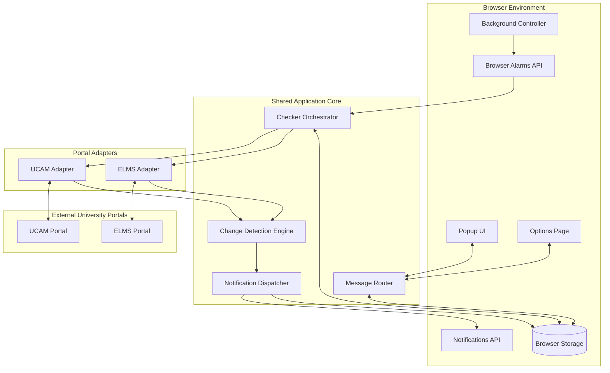

## 4.3 Component Responsibilities

| Component | Responsibility |
|---|---|
| Background Controller | Coordinates background execution |
| Alarm Manager | Schedules periodic monitoring |
| Checker Orchestrator | Coordinates portal checking |
| UCAM Adapter | Handles UCAM-specific integration |
| ELMS Adapter | Handles ELMS-specific integration |
| Parser | Extracts structured information |
| Diff Engine | Identifies newly detected content |
| Notification Dispatcher | Sends notifications |
| Message Router | Handles UI-background communication |
| Storage Manager | Manages local persistent data |
| Popup | Displays monitoring status |
| Options Page | Manages available configuration |

## 4.4 Sequence Diagram

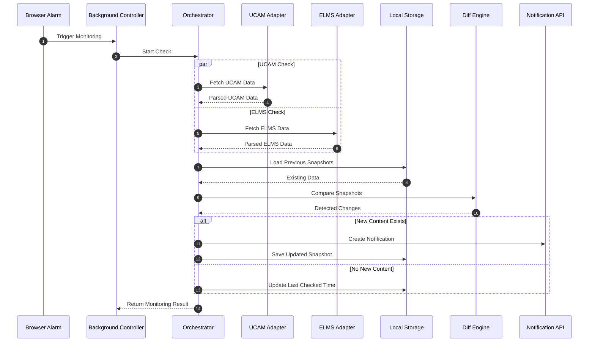

---

# 5. Technology Stack

The following table documents the technology stack described for this project. Confirm exact installed versions in `package.json` and the lockfile.

| Category | Technology | Purpose |
|---|---|---|
| Programming Language | TypeScript 5.x | Type-safe application development |
| Frontend | React 18 | Popup and options interface |
| Styling | Tailwind CSS 3 | UI styling |
| Build Tool | Vite 5 | Development and production builds |
| Extension Framework | CRXJS Vite Plugin | Chromium extension integration |
| Browser Compatibility | WebExtension APIs / Polyfill | Cross-browser API abstraction |
| State Management | Zustand | UI state management |
| HTML Parsing | DOMParser | Portal HTML parsing |
| Testing | Vitest | Unit and integration testing |
| UI Testing | Testing Library | Component testing |
| Icons | Lucide React | Interface icons |
| Package Manager | pnpm | Dependency management |
| Extension Standard | Manifest V3 | Browser extension platform |

## 5.1 Why These Technologies?

**TypeScript:** Improves maintainability and catches type-related problems.

**React:** Provides reusable UI components.

**Vite:** Offers fast development and optimized production builds.

**Tailwind CSS:** Allows consistent and maintainable styling.

**WebExtension APIs:** Provide access to browser extension functionality.

**Vitest:** Makes it possible to test parsing, storage, and monitoring logic independently.

---

# 6. Project Directory Structure

The following is the documented target structure. Keep the actual repository structure as the source of truth.

```text
uiu_notification_pro/
│
├── public/
│   ├── icons/
│   │   ├── icon-16.png
│   │   ├── icon-32.png
│   │   ├── icon-48.png
│   │   └── icon-128.png
│   │
│   └── sounds/
│       └── notify.wav
│
├── scripts/
│   └── build-all.mjs
│
├── src/
│   │
│   ├── background/
│   │   ├── alarm-manager.ts
│   │   ├── checker-orchestrator.ts
│   │   ├── notification-dispatcher.ts
│   │   ├── message-router.ts
│   │   ├── storage-manager.ts
│   │   └── index.ts
│   │
│   ├── adapters/
│   │   │
│   │   ├── ucam/
│   │   │   ├── client.ts
│   │   │   ├── selectors.ts
│   │   │   ├── parser.ts
│   │   │   └── types.ts
│   │   │
│   │   └── elms/
│   │       ├── client.ts
│   │       ├── selectors.ts
│   │       ├── parser.ts
│   │       └── types.ts
│   │
│   ├── popup/
│   │   ├── components/
│   │   ├── hooks/
│   │   ├── App.tsx
│   │   └── main.tsx
│   │
│   ├── options/
│   │   ├── components/
│   │   ├── App.tsx
│   │   └── main.tsx
│   │
│   ├── shared/
│   │   ├── constants/
│   │   ├── types/
│   │   ├── utils/
│   │   └── validators/
│   │
│   └── manifest.ts
│
├── tests/
│   ├── unit/
│   ├── integration/
│   ├── fixtures/
│   │   ├── ucam/
│   │   └── elms/
│   └── setup.ts
│
├── dist/
│   ├── chrome/
│   └── firefox/
│
├── build/
│   ├── chrome-mv3.zip
│   └── firefox-mv3.zip
│
├── .gitignore
├── package.json
├── pnpm-lock.yaml
├── tsconfig.json
├── vite.config.ts
├── vitest.config.ts
├── LICENSE
└── README.md
```

**Important:** Do not create or rename files simply to match this diagram. First inspect the actual source code and build configuration.

---

# 7. Portal Integration Architecture

## 7.1 UCAM Integration

UCAM is integrated through a dedicated adapter.

Responsibilities:

- Check the existing authenticated session.
- Retrieve supported academic information.
- Parse the returned HTML.
- Normalize the extracted information.
- Return structured data to the monitoring engine.

Expected integration origin:

`https://ucam.uiu.ac.bd`

## 7.2 ELMS Integration

ELMS uses a separate adapter because its underlying portal structure and HTML organization differ from UCAM.

Responsibilities:

- Check the existing ELMS session.
- Retrieve supported course information.
- Parse supported academic content.
- Normalize extracted data.
- Return structured information.

Expected integration origin:

`https://elms.uiu.ac.bd`

## 7.3 Adapter Architecture

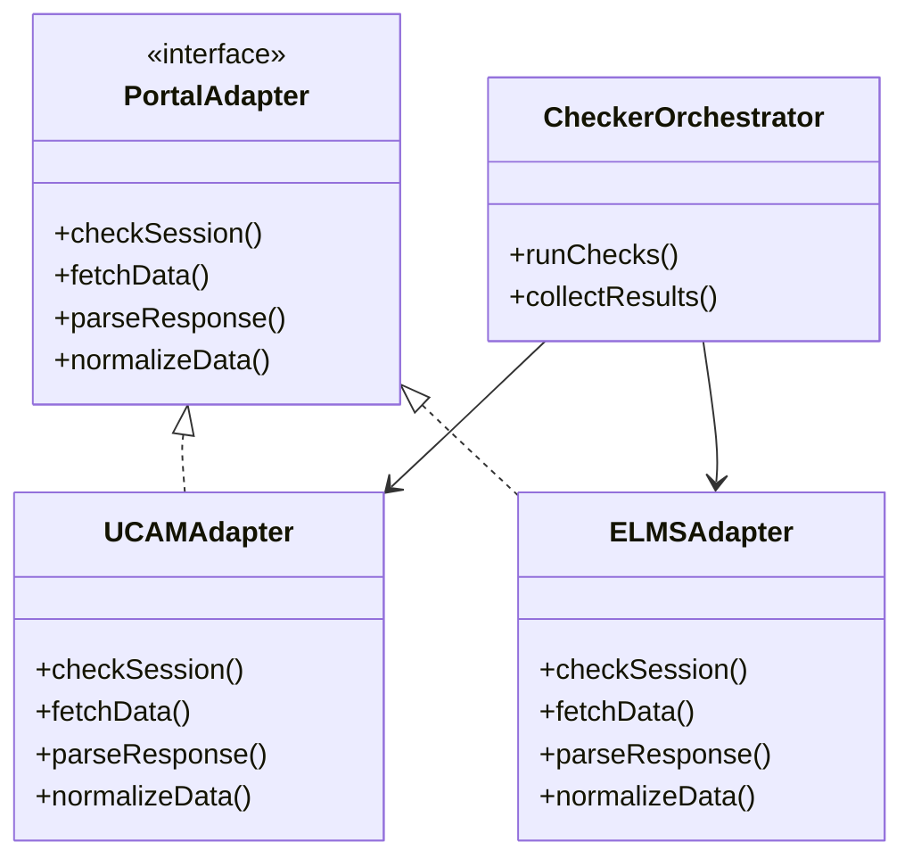

The interface methods above describe the intended responsibilities; actual method names may differ.

---

# 8. Data and Storage Architecture

The extension uses browser storage rather than a remote database, according to the documented implementation.

## 8.1 Storage Responsibilities

| Storage | Intended Purpose |
|---|---|
| `storage.local` | Persistent snapshots and settings |
| `storage.session` | Temporary session data and deduplication |
| Browser Runtime | Background/UI messaging |
| Browser Alarms | Periodic monitoring schedule |

## 8.2 Conceptual Data Model

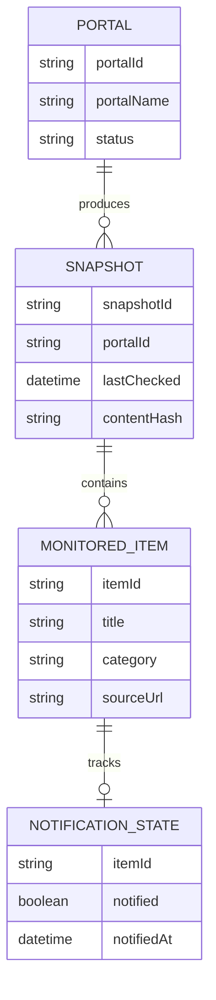

This is a logical model, not a claim that the browser stores relational database tables.

## 8.3 Change Detection Logic

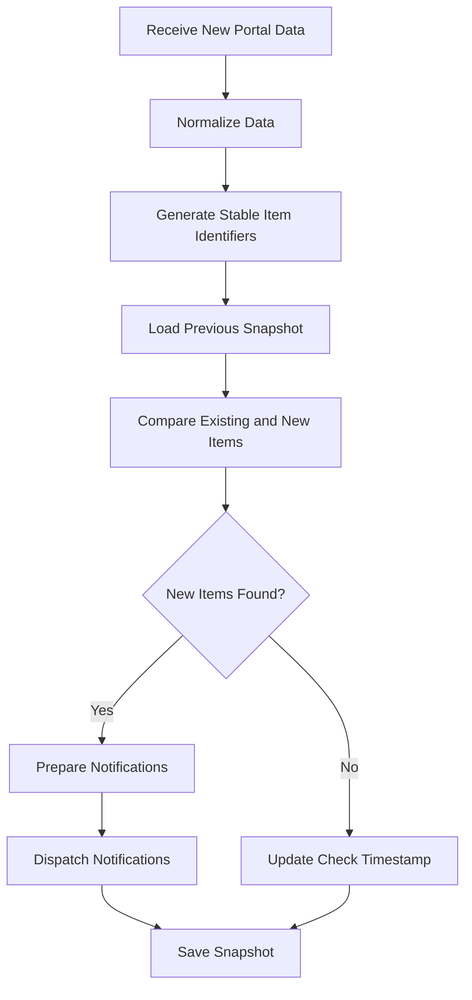

## 8.4 Important Data Integrity Rules

- Failed portal requests must not overwrite valid snapshots with empty data.
- An expired session must not be interpreted as an empty academic feed.
- Stable item identifiers should be used for comparison.
- Existing items should not repeatedly trigger notifications.
- Storage writes should be handled safely.
- Old snapshots should be cleaned up only according to an explicit retention policy.

---

# 9. Security and Privacy Model

## 9.1 Password-Free Authentication

The extension does not require students to enter their university credentials into the extension.

Instead, it uses the existing authenticated browser session.

Conceptual flow:

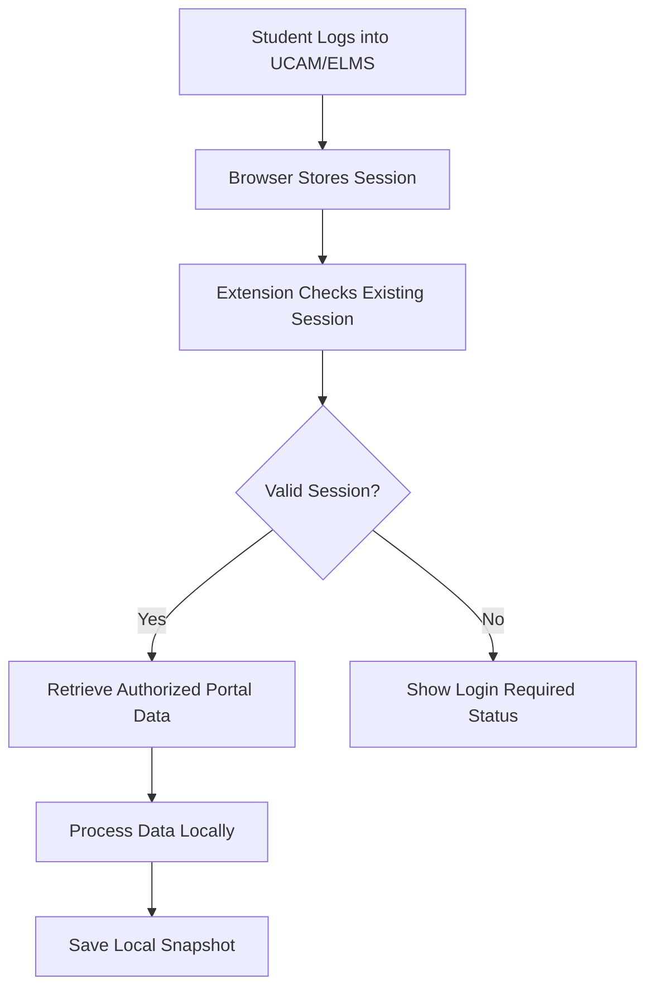

## 9.2 Security Principles

1. Never request or store university passwords.
2. Never transmit session cookies to an external server.
3. Never log session cookie values.
4. Restrict network access to the intended university portals.
5. Validate incoming messages between extension components.
6. Avoid inserting untrusted portal HTML directly into the UI.
7. Use safe DOM rendering.
8. Keep permissions limited to actual requirements.
9. Do not expose unnecessary personal or academic information in notifications.

## 9.3 Required Permission Review

Review the actual manifest before every release.

Potential permissions include:

| Permission | Purpose |
|---|---|
| `alarms` | Periodic monitoring |
| `storage` | Local data persistence |
| `notifications` | Desktop notifications |
| `cookies` | Access existing portal sessions |
| `host_permissions` | Access approved university portals |

Only request permissions that are actually required.

---

# 10. Browser Compatibility

The project targets Chromium-based browsers and Firefox.

| Browser | Distribution | Notes |
|---|---|---|
| Google Chrome | Chromium build | Primary target |
| Microsoft Edge | Chromium build | Compatibility testing required |
| Brave | Chromium build | Compatibility testing required |
| Opera | Chromium build | Compatibility testing required |
| Mozilla Firefox | Firefox build | Browser-specific manifest/API handling |

## 10.1 Browser-Specific Considerations

Manifest V3 implementations are not identical across browsers.

Important areas to verify:

- Background execution model.
- Manifest configuration.
- Browser API namespaces.
- Cookie permissions.
- Alarm scheduling.
- Notification behavior.
- Audio playback.
- Extension packaging.

## 10.2 Firefox Custom Sound Limitation

Custom sound playback requires special attention in Firefox.

Firefox does not provide the Chromium `chrome.offscreen` API as a drop-in equivalent.

A hidden extension page or another Firefox-compatible audio architecture may be investigated, but an ordinary non-persistent event page should not be assumed to support reliable background audio playback.

Autoplay restrictions and background lifecycle behavior must be tested on the actual target Firefox versions.

The system should always retain a reliable notification fallback even if custom sound playback is unavailable.

---

# 11. Installation and Setup

## 11.1 Prerequisites

| Software | Requirement |
|---|---|
| Node.js | 20 or newer |
| pnpm | 9 or newer |
| Git | Recommended |
| Chrome/Firefox | For local testing |

Check installed versions:

```bash
node --version
pnpm --version
git --version
```

## 11.2 Clone Repository

```bash
git clone YOUR_REPOSITORY_URL
```

```bash
cd uiu_notification_pro
```

Replace `YOUR_REPOSITORY_URL` with the actual repository URL.

## 11.3 Install Dependencies

```bash
pnpm install
```

## 11.4 Development Mode

Chrome:

```bash
pnpm dev:chrome
```

Firefox:

```bash
pnpm dev:firefox
```

These commands assume the corresponding scripts exist in `package.json`.

## 11.5 Load Extension in Chrome

1. Open `chrome://extensions/`.
2. Enable Developer Mode.
3. Click **Load unpacked**.
4. Select the generated `dist/chrome` directory.
5. Verify that the extension loads successfully.

## 11.6 Load Extension in Firefox

1. Open `about:debugging#/runtime/this-firefox`.
2. Select **Load Temporary Add-on**.
3. Select `dist/firefox/manifest.json`.
4. Verify that the extension loads successfully.

---

# 12. Build and Distribution

## 12.1 Build All Browser Versions

```bash
pnpm build:all
```

Expected distribution structure:

```text
dist/
├── chrome/
│   └── manifest.json
│
└── firefox/
    └── manifest.json

build/
├── chrome-mv3.zip
└── firefox-mv3.zip
```

Actual output locations depend on the build script.

## 12.2 Release Checklist

- [ ] TypeScript compilation succeeds.
- [ ] Production build succeeds.
- [ ] Chrome manifest is valid.
- [ ] Firefox manifest is valid.
- [ ] Required assets exist.
- [ ] No missing imports.
- [ ] No unexpected console errors.
- [ ] UCAM session detection works.
- [ ] ELMS session detection works.
- [ ] Change detection works.
- [ ] Duplicate notifications are prevented.
- [ ] Storage survives browser restart.
- [ ] Notification behavior is verified.
- [ ] Firefox audio limitation is documented.
- [ ] ZIP archives contain the correct files.
- [ ] Fresh ZIP installations have been tested.

---

# 13. Testing Strategy

Testing should be performed at multiple levels.

## 13.1 Testing Pyramid

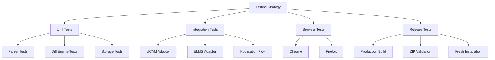

## 13.2 Unit Testing

Test individual modules independently.

Recommended test cases:

| Module | Test Case |
|---|---|
| UCAM Parser | Valid HTML |
| UCAM Parser | Missing elements |
| ELMS Parser | Valid course content |
| ELMS Parser | Empty response |
| Diff Engine | New item detected |
| Diff Engine | Existing item ignored |
| Diff Engine | Duplicate item ignored |
| Storage Manager | Save and retrieve |
| Storage Manager | Corrupted data handling |
| Notification Dispatcher | Successful dispatch |

## 13.3 Integration Testing

Verify that the complete monitoring flow works.

Example:

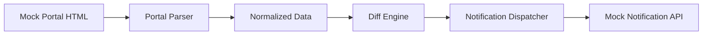

Use sanitized HTML fixtures instead of real student information.

## 13.4 Build Testing

Test both browser builds independently.

A successful build does not automatically mean that the extension works correctly in the browser.

Manual browser testing is mandatory.

---

# 14. Debugging and Troubleshooting

This section is intended to help future developers identify problems without having to understand the entire codebase first.

## 14.1 Debugging Workflow

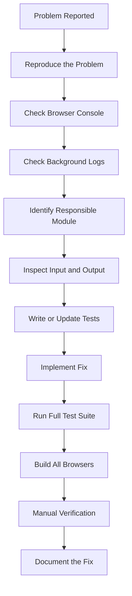

## 14.2 UCAM Notifications Not Working

**Possible causes:**

- UCAM HTML structure changed.
- Session expired.
- Cookie access failed.
- Portal request failed.
- Parser selectors became outdated.
- The change detection engine rejected the new content.

**Debugging procedure:**

1. Open UCAM.
2. Log in manually.
3. Open Developer Tools.
4. Inspect the relevant page.
5. Inspect the HTML structure.
6. Compare it with the current parser selectors.
7. Check the UCAM adapter's output.
8. Update the relevant parser.
9. Add a sanitized fixture.
10. Run parser tests.

Useful console command:

```javascript
document.querySelectorAll("table").forEach((table) => {
  console.log({
    id: table.id,
    className: table.className,
    rows: table.rows.length
  });
});
```

## 14.3 ELMS Notifications Not Working

**Possible causes:**

- ELMS session expired.
- Moodle session cookie changed.
- Moodle page structure changed.
- Course content is loaded dynamically.
- Parser selectors are outdated.

**Debugging procedure:**

1. Open ELMS.
2. Confirm that the student is logged in.
3. Inspect the session status without exposing cookie values.
4. Inspect the relevant course page.
5. Compare the current HTML with the ELMS fixtures.
6. Inspect the parser output.
7. Update the adapter if necessary.
8. Run ELMS integration tests.

Do not publish session cookie values in screenshots, logs, or GitHub issues.

## 14.4 Session Expired

**Symptoms:**

- Monitoring status indicates login required.
- Portal requests redirect to a login page.
- No new academic information is collected.

**Solution:**

1. Open the corresponding portal.
2. Log in manually.
3. Confirm the session is valid.
4. Trigger a manual check if supported.
5. Otherwise wait for the next scheduled check.

The extension should distinguish an expired session from a valid but empty portal response.

## 14.5 Background Service Worker Problems

For Chrome:

1. Open `chrome://extensions/`.
2. Find UniPortal Monitor.
3. Click the Service Worker inspection link.
4. Open the Console.
5. Check initialization and alarm errors.

Common things to inspect:

- Alarm creation.
- Missing permissions.
- Unhandled promise rejections.
- Invalid browser API calls.
- Background script initialization.
- Storage access failures.

For Firefox, inspect the extension using `about:debugging` and its available debugging tools.

## 14.6 Notifications Not Appearing

Check:

- Notification permission.
- Operating system notification settings.
- Browser notification settings.
- Notification dispatcher execution.
- Duplicate suppression logic.
- Browser-specific API compatibility.

## 14.7 Sound Not Playing

**Chromium:**

- Inspect offscreen document initialization if used.
- Check audio file paths.
- Verify runtime messaging.
- Inspect audio playback errors.

**Firefox:**

- Verify the Firefox-specific audio implementation.
- Inspect autoplay restrictions.
- Verify background page lifecycle behavior.
- Test the fallback notification mechanism.

Do not assume that a successful build proves sound playback works.

## 14.8 Build Errors

Run:

```bash
pnpm install
```

Then:

```bash
pnpm build:all
```

If the build fails:

1. Read the first meaningful error.
2. Identify the affected module.
3. Check imports and dependencies.
4. Check manifest generation.
5. Check TypeScript compilation.
6. Verify static assets.
7. Rebuild both browser targets.

Avoid deleting the lockfile or changing dependency versions as the first troubleshooting step.

---

# 15. Maintenance and Future Improvements

## 15.1 Recommended Maintenance Priorities

| Priority | Improvement |
|---|---|
| Critical | Maintain UCAM and ELMS parser compatibility |
| Critical | Preserve authenticated-session security |
| High | Improve error classification |
| High | Expand automated test coverage |
| High | Verify Firefox-specific behavior |
| Medium | Add detailed monitoring history |
| Medium | Improve notification customization |
| Medium | Add exportable diagnostic logs |
| Low | Add additional university portals |

## 15.2 Recommended Error Categories

Use structured error categories rather than generic error messages.

```typescript
type MonitoringError =
  | "SESSION_EXPIRED"
  | "NETWORK_ERROR"
  | "HTTP_ERROR"
  | "PARSER_ERROR"
  | "INVALID_RESPONSE"
  | "STORAGE_ERROR"
  | "NOTIFICATION_ERROR"
  | "UNKNOWN_ERROR";
```

Adapt the type to the actual existing implementation.

## 15.3 Recommended Development Principles

- Keep portal-specific code isolated.
- Avoid hardcoding selectors throughout the application.
- Use shared TypeScript interfaces.
- Keep parsing functions deterministic.
- Maintain sanitized test fixtures.
- Avoid unnecessary network requests.
- Keep notification deduplication reliable.
- Never silently convert failures into empty snapshots.
- Document browser-specific workarounds.
- Test every production build before distribution.

---

# 16. Known Limitations

## 16.1 Portal Structure Dependency

The extension depends on the HTML structure of UCAM and ELMS.

If either portal changes its HTML structure, its corresponding parser may need to be updated.

## 16.2 Session Dependency

The extension requires an existing valid authenticated session.

If a student logs out or the session expires, monitoring cannot retrieve protected information until the student logs in again.

## 16.3 Monitoring Interval

The documented monitoring interval is 30 minutes.

Browser scheduling APIs may delay execution depending on browser state and system conditions. Therefore, a 30-minute interval should not be treated as an exact real-time guarantee.

## 16.4 Firefox Audio

Custom background sound playback is browser-dependent.

Firefox requires a separately verified implementation or a fallback notification strategy.

## 16.5 No Official Portal API Assumption

The documented implementation uses portal HTML integration rather than relying on a confirmed public API.

Changes to portal access policies or website behavior may affect functionality.

---

# 17. Contribution Guidelines

Contributions should preserve the existing architecture and security principles.

Before modifying the project:

1. Read the relevant module.
2. Understand existing functionality.
3. Identify the root cause of the issue.
4. Avoid unnecessary architectural changes.
5. Add or update tests.
6. Verify both browser builds.
7. Update documentation.

## Suggested Branch Naming

```text
feature/feature-name
fix/bug-name
docs/documentation-update
refactor/module-name
test/test-description
```

## Commit Message Examples

```text
feat: improve ELMS monitoring
fix: handle expired UCAM sessions
fix: prevent duplicate notifications
test: add ELMS parser fixtures
docs: improve debugging documentation
refactor: separate portal adapters
```

---

# 18. License

This project is intended to be distributed under the MIT License if the repository contains the corresponding LICENSE file.

See `LICENSE` for the actual licensing terms.

---

# 19. Disclaimer

UniPortal Monitor is an independent student-developed project.

It is not officially affiliated with, endorsed by, or maintained by United International University.

The extension is designed to assist students in monitoring information available through their own authenticated university accounts.

Users are responsible for complying with the university's portal usage policies and applicable terms of service.

---

# 20. Final Project Documentation Checklist

Use this checklist when maintaining or releasing the project.

### Architecture
- [ ] UCAM adapter documented.
- [ ] ELMS adapter documented.
- [ ] Background workflow documented.
- [ ] Storage structure documented.
- [ ] Notification workflow documented.

### Security
- [ ] No password storage.
- [ ] No cookie logging.
- [ ] Host permissions reviewed.
- [ ] Message validation reviewed.
- [ ] Sensitive information excluded from diagnostics.

### Quality Assurance
- [ ] Unit tests pass.
- [ ] Integration tests pass.
- [ ] Chrome build passes.
- [ ] Firefox build passes.
- [ ] Manual browser testing completed.
- [ ] No unexpected console errors.

### Release
- [ ] Manifest files validated.
- [ ] Icons included.
- [ ] Audio assets included where supported.
- [ ] Production ZIP files generated.
- [ ] Fresh installation verified.
- [ ] README updated.

---

<p align="center">
  <b>UniPortal Monitor</b>
  <br />
  Making University Information Easier to Follow.
  <br />
  <i>Built for students, designed for reliability.</i>
</p>
